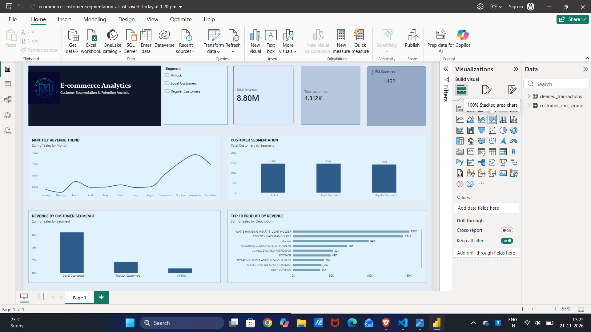

# E-commerce Customer Segmentation & Retention Analysis

## 📌 Project Overview
This project analyzes e-commerce customer purchasing behavior to understand customer segments, sales performance, and customer retention opportunities.

The goal is to turn transaction data into actionable business insights using Python, SQL, and Power BI.

## 🎯 Business Objectives
- Analyze customer purchasing behavior.
- Segment customers using RFM analysis.
- Identify at-risk customers and potential retention opportunities.
- Analyze revenue trends and top-performing products.
- Build an interactive Power BI dashboard.

## 🛠️ Tools & Technologies
- **Python:** Data cleaning and customer segmentation
- **Pandas:** Data manipulation and analysis
- **PostgreSQL:** SQL-based business analysis
- **Power BI:** Interactive dashboard and visualization
- **Excel/CSV:** Data storage and exchange

## 🔄 Project Workflow
1. Clean and prepare the transaction data using Python.
2. Calculate Recency, Frequency, and Monetary values for customers.
3. Assign customer segments based on the RFM analysis.
4. Load the data into PostgreSQL.
5. Perform business analysis using SQL queries.
6. Create an interactive Power BI dashboard.

## 📊 Dashboard Highlights
The Power BI dashboard includes:
- Total Revenue
- Total Customers
- At-Risk Customers
- Customer Segmentation
- Monthly Revenue Trend
- Revenue by Customer Segment
- Top 10 Products by Revenue

## 💡 Business Value
The analysis helps businesses understand customer purchasing behavior, monitor revenue trends, and identify customer retention opportunities.

### Key Business Insights
- **Customer Base:** The analysis includes 4,312 unique customers.
- **At-Risk Customers:** 1,452 customers are classified as At Risk, representing approximately 33.7% of the total customer base.
- **Retention Opportunity:** Businesses can prioritize re-engagement campaigns to encourage at-risk customers to return and purchase again.

## 📁 Project Structure
- `dashboard/` — Power BI dashboard materials
- `data/` — Project datasets
- `notebooks/` — Python analysis notebooks
- `sql/` — SQL analysis files
- `ecommerce_analysis.sql` — SQL queries
- `README.md` — Project documentation

## 👩‍💻 Author
Data Science Student | Aspiring Data Analyst

## 🚀 Future Improvements
- Develop targeted retention strategies for at-risk customers.
- Add more customer behavior and cohort analyses.
- Explore customer lifetime value prediction.
